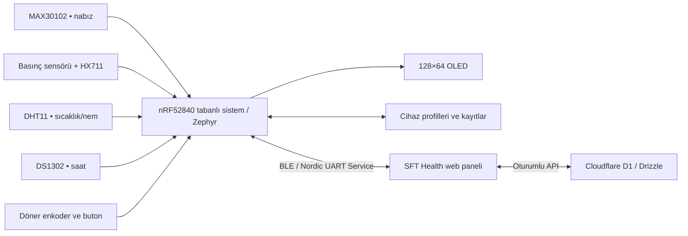
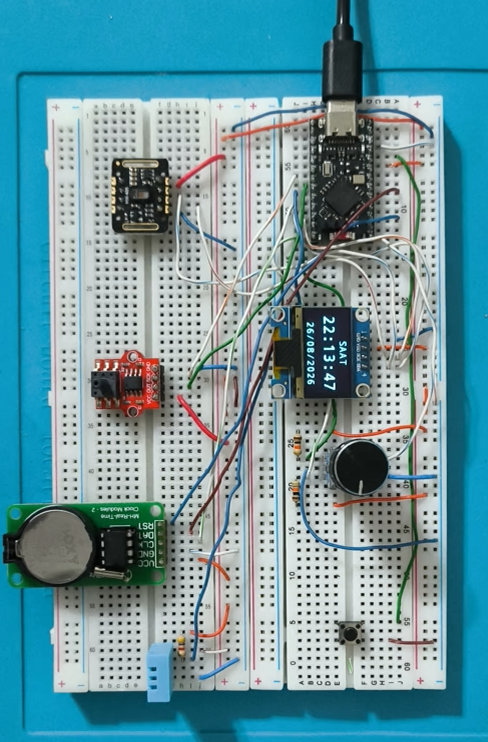
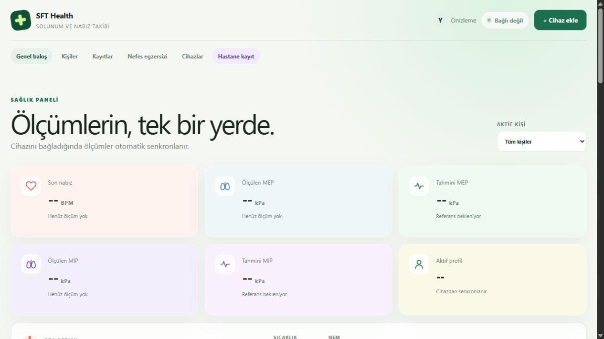
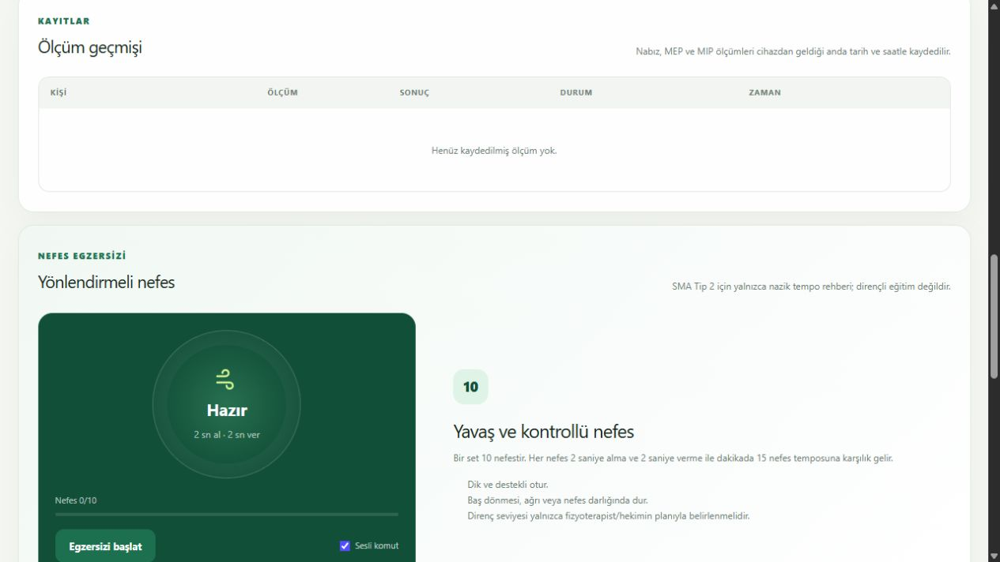
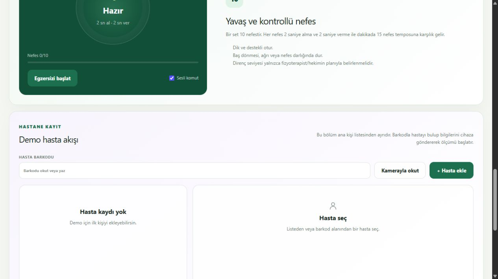

# SFT Health

**Solunum basıncı, nabız ve ortam verilerini bir arada izleyen donanım + web prototipi.** Bu depo, `SFT_Healt` adıyla projenin V17 mikroişlemci C kaynaklarını ve tasarlanan web panelini toplar.

| Bölüm | İçerik |
| --- | --- |
| [01-Mikroislemci](01-Mikroislemci/README.md) | Zephyr tabanlı V17 C kodları; sensörler, OLED, enkoder, RTC, kayıtlar ve BLE |
| [02-Web-Sitesi](02-Web-Sitesi/README.md) | React/vinext web paneli; Bluetooth, kişi/ölçüm yönetimi, nefes egzersizi ve hastane demo akışı |

## Sistem ne yapıyor?

Donanım; optik nabız sensörünü, basınç arayüzünü, sıcaklık/nem sensörünü ve gerçek zaman saatini okur. OLED ve döner enkoder üzerinden cihazın kendi menülerinde gezinilir. Kullanıcı profilleri ve ölçümler cihazda saklanabilir. Web paneli Nordic UART Service üzerinden Bluetooth bağlantısı kurarak profilleri, canlı sonuçları ve geçmiş kayıtları alır.

Kaynaklarda **MEP/MIP basınç denemeleri**, BPM ve sıcaklık/nem verileri bulunur. Bu aktarımda SpO₂ hesaplaması veya FEV1/FVC akım-hacim ölçümü tespit edilmedi; MAX30102 bulunması bu özelliklerin uygulandığı anlamına gelmez. Klinik doğrulama sonucu sağlanmadı; paneldeki referans yüzdeleri yazılımın prototip gösterimidir.

`nRF52840` bilgisi web kaynaklarındaki cihaz modelinden gelir. Kartın tam ticari modeli, board hedefi ve fiziksel pin numaraları gönderilen C arşivinde yoktur. [Donanım ve pin tablosunda](01-Mikroislemci/docs/DONANIM_VE_PINLER.md) kesin bilgiler ve eksikler ayrı gösterilir.

## Görseller

### Fiziksel prototip

### Web paneli

Web görüntüleri kaynak uygulamanın yerel önizlemesinden alınır; bağlı cihaz veya gerçek hasta verisi içermez.

## Başlangıç

Web için [yerel kurulum rehberini](02-Web-Sitesi/README.md#yerel-kurulum) izleyin. Donanım tarafında yalnızca 13 `.c` dosyası teslim edildi: başlık dosyaları, board/overlay ve Zephyr proje yapılandırması tamamlanmadan doğrudan firmware derlemesi yapılamaz. Eksikler [mikroişlemci README’sinde](01-Mikroislemci/README.md#derleme-için-gerekenler) listelenmiştir.

[BLE protokolü](01-Mikroislemci/docs/BLE_PROTOKOLU.md) · [Kaynak aktarım kaydı](02-Web-Sitesi/docs/AKTARIM.md)

Bu aktarım yeni bir açık kaynak lisansı atamaz. Sağlanan kodlara ve bağımlılıklara ait mevcut lisans koşulları korunur.
